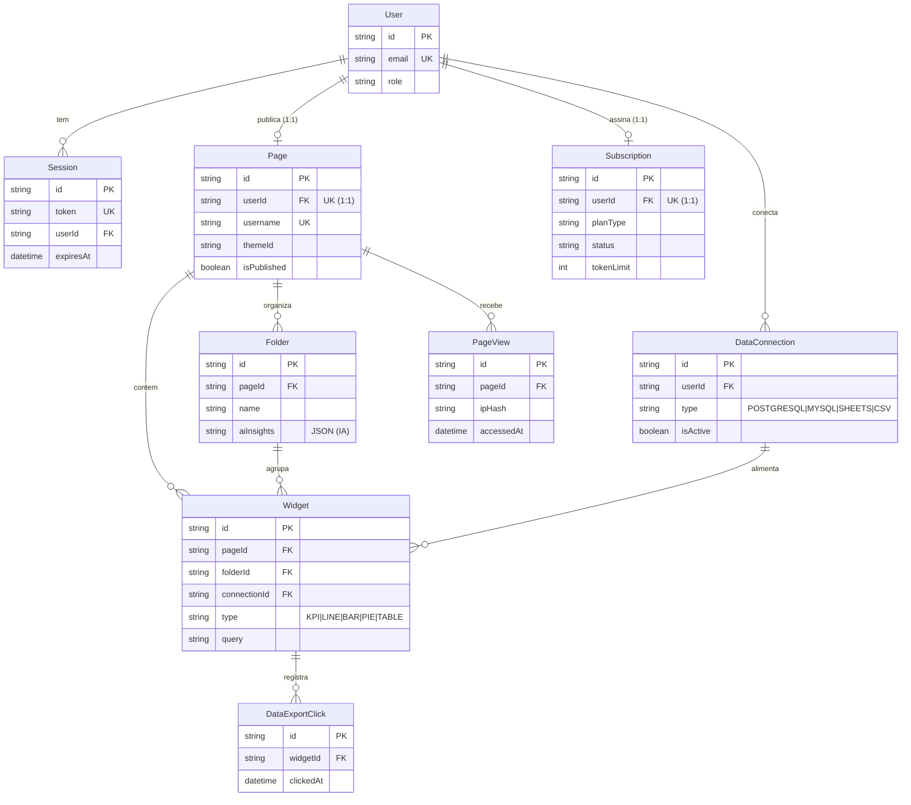

# Metrika — Micro-SaaS de Dashboards de Dados

Plataforma de analytics no modelo micro-SaaS construída em Next.js 16, React 19 e TypeScript: o
usuário importa seus dados (CSV ou planilha) e a aplicação gera dashboards interativos, com
autenticação, páginas públicas por usuário, controle de assinatura e um agente de IA que sugere
análises. É um projeto full-stack de ponta a ponta — do banco de dados à interface — que demonstra a
capacidade de transformar dado bruto em um produto de visualização utilizável por quem não é técnico.

> **Nota de confidencialidade:** todos os dados presentes neste repositório (planilhas, seeds,
> exemplos) são fictícios, gerados apenas para demonstração. Nenhum dado real, credencial ou
> informação de terceiros foi incluído aqui.

---

## Visão Geral

O Metrika resolve a distância entre "ter uma planilha" e "ter um painel". Em vez de depender de uma
ferramenta de BI e de alguém que saiba modelá-la, o próprio usuário sobe seu CSV, escolhe os widgets e
publica um dashboard — inclusive em uma página pública compartilhável. A aplicação cobre todo o ciclo
de um produto SaaS: cadastro e login, onboarding, limites por plano, cobrança e um agente de IA que
interpreta os dados e sugere o que analisar.

## Contexto de Negócio

A demanda por visualização de dados cresce mais rápido do que a disponibilidade de analistas. Times
comerciais, pequenas operações e áreas de negócio precisam acompanhar indicadores, mas esbarram na
barreira técnica de montar e manter dashboards. Um produto que permite ao próprio usuário importar
dados e publicar um painel — com autoatendimento e cobrança por plano — ataca exatamente essa lacuna, e
é o tipo de solução que o mercado remunera como produto, não como relatório pontual.

## O Problema que Resolve

- **Dependência de especialista** para transformar planilha em painel.
- **Falta de compartilhamento simples:** relatórios presos em arquivos, sem link público.
- **Ausência de um caminho de autoatendimento** (cadastro, onboarding, limites e cobrança).
- **Curva de interpretação:** o usuário tem o gráfico, mas não sabe qual análise priorizar.

## Público e Decisões Apoiadas

- **Usuário de negócio:** importa seus dados e acompanha indicadores sem depender de TI.
- **Gestor:** publica um painel com link para a equipe ou para terceiros.
- **Operador do produto (admin):** administra usuários, planos e limites.

## Impacto e Valor Gerado

- Reduz o tempo entre "receber um CSV" e "ter um dashboard publicado" a poucos cliques.
- Habilita compartilhamento por link público, ampliando o alcance da informação.
- Estrutura um modelo de receita recorrente (planos e limites de uso).
- Adiciona uma camada de IA que reduz a barreira de "não sei o que analisar".

---

## Arquitetura e Abordagem Técnica

Aplicação full-stack em Next.js (App Router) com renderização no servidor, Server Actions e rotas de
API dedicadas. A persistência usa Prisma sobre SQLite, com migrações versionadas.

### Autenticação e multi-tenant
- Autenticação por sessão (`src/lib/auth.ts`, `middleware.ts`) e fluxo de **onboarding** com escolha
  de nome de usuário (`/api/onboarding`).
- **Páginas públicas por usuário:** rotas dinâmicas `[username]/[folder]` servem dashboards
  compartilháveis, isolando o conteúdo de cada conta.

### Ingestão e visualização
- **Importação de dados** por CSV (papaparse) e conexão com planilhas (`/api/fetch-sheet`).
- **Dashboards** com gráficos em Recharts e widgets configuráveis (`dashboard/widgets`).
- Organização por **pastas** e temas personalizáveis (`dashboard/folders`, `dashboard/themes`).

### Inteligência
- **Agente de IA** (`/api/ai/agent`, `src/lib/ai.ts`) que analisa os dados e sugere análises, além de
  uma rota de análise dedicada (`/api/analyze`).

### Produto e operação
- **Assinatura e cobrança** (`dashboard/billing`) com **limites por plano** (`src/lib/plan-limits.ts`).
- **Painel administrativo** (`src/app/admin`) para gestão do produto.
- Modelos de dados em `prisma/schema.prisma` (usuário, sessão, widget, assinatura, entre outros).

## Stack

Next.js 16 - React 19 - TypeScript - Prisma - SQLite - Recharts - TailwindCSS - IA generativa -
Server Actions e API Routes.

## Como Rodar

```bash
npm install
copy .env.example .env      # configure DATABASE_URL e as chaves de IA
npx prisma migrate dev
node prisma/seed.js         # popula dados de demonstração (fictícios)
npm run dev                 # http://localhost:3000
```

> Os arquivos em `public/data/*.json` são dados de demonstração fictícios.

## Estrutura do Projeto

```text
src/app/                 -> Rotas: dashboard, api, admin, auth, onboarding, páginas públicas
src/app/api/             -> Endpoints (auth, ai/agent, analyze, fetch-sheet, onboarding, settings)
src/app/dashboard/       -> Área logada (widgets, folders, billing, connections, stats, themes, upload)
src/components/          -> Componentes de UI (shell, header, sidebar, gráficos públicos)
src/lib/                 -> Auth, IA, limites de plano, cliente Prisma
prisma/schema.prisma     -> Modelos de dados e migrações
public/data/             -> Dados de exemplo (fictícios)
```

## Autor

José Vitor Santos Pinheiro — Análise de Dados e Inteligência Comercial (Varejo, Indústria e Distribuição).
Contato: vytorsantt@gmail.com

## 🗺️ Modelo de Dados (DER)

Esquema do micro-SaaS de dashboards (Prisma / PostgreSQL). Renderizado pelo GitHub via Mermaid. *Dados de demonstração fictícios.*



**Destaques:** `Page` e `Subscription` são 1:1 com `User`; `Widget` pode se ligar a uma `DataConnection` (fonte de dados) e a uma `Folder`. Modelado com Prisma ORM.
